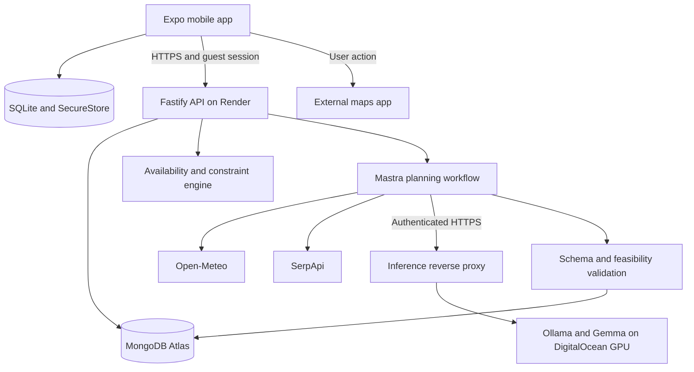

# OutsideWeek — Mobile App Build Plan

> Working name: **OutsideWeek**. A personal outdoor planner that turns the time you actually have into activities you can realistically do.
>
> Plan prepared: **10 October 2026**. Status: **planning only; app implementation has not started**.
>
> This is a new project plan. The existing WildBluff plan is a separate document.

## 1. Product decision

Build a mobile app that asks the user to confirm their schedule every week, then creates a personalized outdoor activity plan.

- During busy days: suggest something short, nearby, and easy, such as a park break, neighbourhood walk, outdoor reading, or tending a balcony garden.
- During genuinely free days: offer a longer activity that matches the person's interests, available time, transport, and preferred intensity, such as an extended park visit, cycling, or a hike.
- Adapt to the actual schedule. A free Tuesday can support a longer outing; a busy Saturday might only support a short break.
- Use gentle progress, optional explorer titles, and encouraging completion feedback. The main experience is a practical planner.

**Core promise:** “Tell us when you are busy. We will help you make a little room for outside.”

**Primary user:** Someone who wants to get outside more, but struggles to choose suitable activities and fit them around work, study, family, and changing commitments.

**Success:** The user spends a short time planning, completes an achievable outdoor activity, and finds the next week's suggestions more useful.

## 2. What the first release includes

### Target first-version features

1. Mobile onboarding and preferences.
2. Seven-day schedule editor with reusable working hours and day-specific changes.
3. A fresh schedule confirmation each local week.
4. AI-generated short activities and longer outings, constrained by real availability.
5. Today, Week, and You screens.
6. Accept, replace, reschedule, skip, and complete an activity.
7. A plain-language explanation of why each suggestion fits.
8. Weather context and grounded destination suggestions where available.
9. Offline access to saved plans and an offline completion queue.
10. Optional local reminders.
11. Simple weekly progress and activity feedback.
12. A working native demonstration on a real phone.

### Deadline-critical slice

The complete feature list above is the implementation blueprint. For the remaining challenge window, prioritize **schedule entry and weekly confirmation → live, validated AI suggestions → acceptance → cached plan → completion → real outdoor demonstration**.

Use a small catalogue, a workday example, and a genuinely free-day example. Local reminders, advanced rescheduling, richer progress, and offline completion synchronization are subsequent increments if time runs short. Until offline synchronization is implemented, saved plans remain readable offline and completion submission clearly requires connectivity.

Forecast and destination integrations should follow the core flow. If either is incomplete, use familiar-location activities, label unavailable conditions, and keep named/distant hikes as unconfirmed ideas. Claim SerpApi or any other sponsor category only when its actual integration is working and demonstrated.

### Deferred until the core experience works

- Calendar import, automatic calendar writes, remote push, and automatic background weekly generation.
- Social feeds, teams, public leaderboards, paid subscriptions, complex avatars, battles, and loot systems.
- Mandatory photo proof, species identification, automatic step/GPS tracking, turn-by-turn navigation, and generated hiking routes.
- Cross-device accounts and recovery. The prototype uses a secure guest session.
- Garden planting advice that depends on species, soil, or local growing conditions. Initial gardening tasks use activities the person already understands, such as tending their existing plants.

## 3. User journey and screens

### First opening

**A. Welcome**

Explain the app in one sentence. Let the user start without creating a password.

**B. Your week**

- Show seven day cards with the local dates.
- Shortcut: “I usually work 9–5” with selected weekdays; users can change all hours.
- Each day supports multiple busy blocks and an explicit “No commitments” option.
- Include sleep, commute, and recurring commitments rather than treating every non-work hour as available.
- Support “ends next day” for overnight blocks.
- Let users explicitly mark a lunch break as available; do not infer that a work block includes a usable lunch break.
- An explicit lunch break splits its parent work block. It cannot override a separate meeting, sleep, commute, or other busy block that overlaps the same time.

**C. What you enjoy**

- Interests: walking, parks, gardening, photography, outdoor reading, cycling, hiking.
- Comfortable activity intensity and maximum short/long activity duration.
- Desired outdoor days per week; default proposal: four, editable.
- Whether to include a longer outing this week; default off until the user selects it.
- Available transport and maximum one-way travel time.
- Garden/balcony access, bicycle access, and other relevant equipment.
- Approximate area, entered manually or selected using optional foreground location permission.
- Preferred outdoor times and reminder preferences.

**D. Review the proposed week**

Display proposed activities with time, total time commitment, location, effort, and one short explanation. The user saves the plan after review. A long outing always needs explicit acceptance.

### Every new week

On the first opening in a new local week, show:

> “What does your week look like?”

Actions: **Same as last week**, **Change some days**, **Start fresh**, **Later**.

- “Same as last week” copies the template and explicitly confirms the new week.
- Keep the previous week's history; do not move unfinished tasks into a new week automatically.
- If the user chooses Later, show their existing information and a small planning reminder. Do not block access to the app.
- Do not repeatedly ask after confirmation within the same week.
- An optional local notification reminds them to open the app. The app performs generation when opened; it does not rely on precise background execution.

### Navigation

| Screen | Purpose | Main actions |
| --- | --- | --- |
| Today | One clear suggestion and why it fits | View, start, replace, skip, complete |
| Week | Proposed and accepted activities across seven days | Edit schedule, save plan, reschedule |
| You | Preferences, history, and gentle progress | Edit interests, limits, area, reminders, delete data |
| Schedule editor | Busy blocks and outdoor availability | Copy hours, edit a day, confirm week |
| Activity detail | Time breakdown, steps, conditions, destination sources | Accept, open maps, refresh conditions |
| Completion sheet | What happened and what to improve | Done, partly done, did not go; optional feedback |

### Example activity card

```text
Tuesday · 12:10–12:35
A little fresh air at lunch

15-minute walk · 25 minutes total · Gentle
Use a familiar place close to work

Why it fits: You marked a 30-minute lunch window.
This leaves five minutes before your next commitment.

[Accept]  [Something else]
```

### Example week

Illustrative data only; actual places and forecasts must come from providers or the user.

| Day | Confirmed situation | Example suggestion |
| --- | --- | --- |
| Monday | Work 09:00–17:00; available 18:00–19:00 | 20-minute neighbourhood walk with a return buffer |
| Tuesday | Workday with an explicit 30-minute lunch gap | 15-minute outdoor break, 25 minutes total |
| Wednesday | Free 10:00–16:00; longer outing enabled | 90-minute park outing plus allowed travel |
| Thursday | Workday; balcony access; prefers a quiet evening | 10 minutes tending existing plants |
| Friday | Weekly target already met | Leave free, or offer an optional short activity |
| Saturday | Busy 08:00–18:00 | Only a short suggestion if an eligible interval remains |
| Sunday | Free day; hiking selected; suitable sourced option available | Propose a hike whose entire time budget fits; user reviews details |

## 4. Planning rules

### Time calculation

All proposed activities must satisfy:

```text
preparation + outward travel + activity + return travel + buffer
    <= available interval
```

Examples:

- A 30-minute break cannot hold 20 minutes of walking plus 20 minutes of travel.
- A five-hour free interval does not mean a five-hour hike; travel and preparation also need time.
- A user without garden access should not receive a home-gardening task.
- A user who did not select hiking should not receive a hiking suggestion.

Use these activity bands as product defaults, not universal fitness guidance:

| Band | Activity time | Typical use |
| --- | --- | --- |
| Small break | 5–15 minutes | Fresh air, a short walk, existing plant care |
| Short activity | 15–45 minutes | Local park, outdoor reading, photography walk |
| Longer outing | 60–180 minutes | Extended walk, park visit, cycling, suitable hike |

The user's limits override these defaults. Full-day availability permits a longer proposal but never automatically fills the entire day. Default to one primary activity per selected day and at most one longer outing per week.

### Deterministic scheduler

1. Identify the current planning week in the user's selected IANA timezone.
2. Resolve confirmed local busy/sleep/commute blocks into dated intervals; split a work block around its explicitly available lunch break.
3. Split overnight blocks; merge overlaps; subtract all commitments, buffers, and accepted activities. Other commitments still block an explicit lunch break. When replacing or moving one activity, exclude only that activity from the reserved set.
4. Intersect remaining intervals with preferred outdoor hours.
5. Apply daylight constraints for activities that require daylight.
6. Create eligible slots with a stable `slotId`, allowed categories, duration budget, and location context.
7. Find suitable templates and, where useful, sourced destination candidates.
8. Ask the model to choose and personalize from these eligible inputs.
9. Validate the resulting activities against the schedule and preferences in code. Count existing accepted/completed activities toward the week's frequency and longer-outing limits.
10. Assign final start/end times on the server, save the draft, and request user acceptance. Atomically revalidate availability and plan revision at acceptance so simultaneous requests cannot create overlaps.

The model never calculates calendar availability or overrides a constraint.

### Timezones and changes

- Preserve local date/time and IANA timezone for schedule intent; store accepted event instants in UTC too.
- Default week start: Monday; make it a profile setting.
- Do not persist a recurring 09:00 workday as a permanently fixed UTC hour.
- Detect nonexistent/ambiguous daylight-saving times and require review. Do not silently shift them.
- On timezone change, ask for schedule review before applying a new plan.
- Schedule updates invalidate unaccepted suggestions from older versions.
- Preserve accepted activities; mark any new conflicts for review. Never silently move them.
- Midweek first use plans only the remaining future intervals.
- No available time is a valid outcome: leave the day empty and explain why.

### Places, travel, and weather

- Use SerpApi for candidate parks, outdoor destinations, and official information links.
- A search result is a discovery lead. It does not prove a trail is open, accessible, or appropriate.
- Named hikes need source-backed duration/distance where available, an information link, and user confirmation. Missing details keep the hike as an unconfirmed idea rather than a scheduled commitment.
- Use Open-Meteo for structured hourly forecasts and sunrise/sunset. Keep source and fetch time.
- Weather far in advance remains provisional. Refresh before longer outings when online.
- Weather status: `pending`, `available`, `stale`, `unavailable`, or `needs_review`; never use an AI-produced “safe” flag.
- The weather feed is not a trail-closure or comprehensive official-alert service. Activity details link to the relevant official information when available.
- In the MVP, travel times are the user's explicit estimates/allowances. Straight-line distance and search snippets must not be presented as verified journey time.
- A named outing with unknown travel time needs the user's estimate before acceptance. Revalidate the total afterward.
- Offer a nearby familiar activity or a different day when a proposal cannot be confirmed.
- Maps open through the phone's external maps app. No route-generation engine is required for this version.

## 5. Technical architecture

### Chosen stack

| Layer | Technology | Responsibility |
| --- | --- | --- |
| Mobile | React Native + Expo + TypeScript | Native Android/iOS app |
| Navigation | Expo Router | Screens, tab layout, activity deep links |
| UI | React Native components, StyleSheet, shared theme tokens | Accessible cards, schedule editor, consistent spacing |
| Local data | `expo-sqlite` | Saved plan, cached activities, offline completion outbox |
| Device secrets | `expo-secure-store` | Guest session token and expiry |
| Reminders | `expo-notifications` | Optional local weekly/activity reminders |
| Location | Manual area entry; optional `expo-location` foreground permission | Approximate planning area |
| API client | Typed `fetch` wrapper | Authentication, request IDs, typed errors, timeouts |
| Backend | Node.js 24 LTS + TypeScript + Fastify 5 | Auth, API, business rules, jobs, provider calls |
| AI orchestration | Mastra typed workflows | Explicit planning steps and bounded retries |
| Validation | Zod 4 | Shared request/response contracts and model-output validation |
| Date arithmetic | Luxon | Timezone-aware interval calculations on the server |
| Database | MongoDB Atlas, official Node driver | Profiles, schedules, plans, completions, jobs, caches |
| Open model | Gemma 3 4B instruction model | Personalized activity selection, instructions, and fit explanations |
| Inference server | Ollama | Self-hosted model execution and JSON-schema output |
| Backend hosting | Render Web Service | Always-on API and small job runner |
| AI hosting | DigitalOcean GPU Droplet | Ollama and Gemma |
| Place discovery | SerpApi | Grounded destination candidates and source URLs |
| Forecast data | Open-Meteo | Forecast and daylight inputs |
| Repository/CI | GitHub + GitHub Actions | Source, typecheck, build, critical tests |

Use the current stable Expo SDK at implementation start and its matching React Native version. Install Expo modules with `expo install`; pin the resolved versions and commit the lockfile. Avoid guessing a package-version matrix in advance. Expo's native SQLite support and SecureStore are documented in [S2–S3].

### System diagram



### Where the frontend runs

The mobile frontend runs **on the user's phone**. It does not need a Render web server to render its screens.

- Development: Expo development workflow; Expo Go for supported early features, then a development build for native integration testing.
- Android demonstration: EAS internal-distribution APK or a local Android build.
- iOS demonstration: Expo Go for supported features; a standalone/ad hoc build requires Apple provisioning and the appropriate developer account/device registration.
- Optional public demo page: Render Static Site with screenshots, recording, installation instructions, and source link. This is not a replacement for the mobile app.
- App Store/Play Store launch is a later milestone; do not make store review a challenge deadline dependency.

## 6. AI behavior and workflow

### Model and hosting baseline

Start with **`gemma3:4b-it-q4_K_M`** through Ollama on a **DigitalOcean RTX 4000 Ada 20 GB GPU Droplet**, subject to quota and regional availability. Pin the exact model tag and record its digest in evaluation results.

This model is a practical starting point to evaluate, not a guarantee of response quality or latency. Use text planning in the MVP; image analysis is unnecessary for this product. The open weights allow local development and self-hosted deployment. Gemma uses its own model terms; do not describe its weights as MIT licensed. See [S7–S9].

### Mastra workflow

Implement a typed `generate-weekly-plan` workflow with these steps:

```text
load confirmed schedule/preferences
    -> calculate eligible slots
    -> fetch/cache forecast and destination candidates
    -> assemble a compact model request
    -> generate structured activity proposals with Gemma
    -> validate schema and business constraints
    -> optionally repair once
    -> save draft plan or labelled fallback
```

Call Ollama's native `/api/chat` from a Mastra workflow step with `stream: false` and a JSON schema in `format`. Build the schema from Zod 4. Parse and validate the returned message content independently. This avoids depending on the model's tool-calling abilities. Mastra still controls the application's actual planning workflow. See [S5–S6].

Use a low generation temperature and a bounded output size. Put retrieved text in a clearly delimited data field; do not treat a place description as an instruction. The model may refer only to supplied slot/template/destination IDs.

### Inputs sent to the model

- Eligible slot IDs and duration budgets; local time labels only when needed for wording.
- Interests, selected activity types, preferred effort, equipment/access, and recent explicit feedback.
- A small allowed activity catalogue, with duration and equipment constraints.
- Structured forecast summaries with status and timestamps.
- Relevant destination IDs and sourced facts.

Do not send employer names, raw calendar descriptions, exact home addresses, or unnecessary historical data. The backend can calculate free intervals without exposing the original commitments to the model.

### Model response contract

```json
{
  "activities": [
    {
      "slotId": "tuesday-lunch-1",
      "templateId": "short-familiar-walk",
      "category": "walk",
      "title": "A little fresh air at lunch",
      "activityMinutes": 15,
      "intensity": "gentle",
      "destinationId": null,
      "reason": "Fits the lunch window you made available.",
      "steps": [
        "Choose a familiar place close by.",
        "Walk at a comfortable pace.",
        "Leave enough time to return."
      ]
    }
  ]
}
```

The server owns preparation/travel/buffer values, source metadata, final schedule times, eligibility, and progress. A valid JSON response can still be wrong; enforce semantic rules after parsing.

### Failure behavior

- Model output invalid: return precise validation issues for one repair attempt.
- Still invalid or inference unavailable: preserve the schedule and offer clearly labelled basic catalogue suggestions or Retry.
- Search unavailable: use a familiar-location activity; do not invent a named destination.
- Weather unavailable: mark unknown and leave conditions-dependent outings pending.
- Empty valid plan: explain the limiting constraints; do not stretch time windows to force a task.
- Slow inference: show progress and let the user leave the screen. The draft can be fetched later.
- Production inference changes require rerunning the small scheduling evaluation set.

### Generation jobs

`POST /v1/plans/generate` returns `202` with a `runId`. Store job state in MongoDB before processing; the app polls for the result and can resume after reopening.

- One active generation per user/week/input version.
- A small runner within the paid Render API service claims MongoDB jobs using an atomic lease; global concurrency starts at one.
- Jobs record `queued`, `running`, `succeeded`, or `failed`, plus bounded attempt counts and lease expiry.
- After restart, expired leases can be reclaimed. Save the final plan idempotently.
- Schedule/preference versions are checked again before publishing a result; stale output cannot replace a newer plan.
- This is application-managed job recovery, not a claim that Mastra automatically provides durable MongoDB execution.
- No separate Redis, Temporal cluster, or worker service is needed for the first small deployment.

## 7. Data structure and ownership

### MongoDB collections

| Collection | Main fields |
| --- | --- |
| `users` | `id`, timezone, week start, approximate area, interests, duration/effort limits, transport, equipment/access, reminder preferences, preference version |
| `sessions` | `userId`, hashed opaque token, created/expiry/revocation timestamps |
| `weeklySchedules` | `userId`, local `weekStart`, timezone, busy blocks, preferred windows, confirmation time, version |
| `weeklyPlans` | `userId`, `weekStart`, schedule/preference versions, revision, state, model/prompt versions, embedded activity records |
| `completionEvents` | `userId`, `activityId`, unique `clientEventId`, outcome, optional minutes/feedback, occurred/received timestamps |
| `plannerRuns` | owner, input hash, versions, status, lease, attempts, result reference, redacted metrics/errors |
| `providerCache` | provider, coarse-area/query key, payload, fetched time, expiry, source URLs |

Each activity stores its slot ID, category/template, title, intensity, duration components, UTC instants, local display context, destination/source metadata, weather status, and state.

### Indexes and invariants

- Unique current weekly schedule: `(userId, weekStart)`; update with expected `version`.
- Unique plan revision: `(userId, weekStart, revision)`; one current revision selected by compare-and-set.
- Unique completion event: `(userId, clientEventId)`; duplicate retries return the original result.
- One authoritative completion state per `(userId, activityId)`; progress must not increase on duplicate submissions.
- Unique generation key: `(userId, weekStart, inputHash)`.
- TTL indexes for expired sessions and provider cache; authorization also checks expiry explicitly because TTL cleanup is not immediate.
- All queries are scoped by the authenticated owner. Never accept a client-supplied `userId` as authorization.

### Activity states

```text
suggested -> accepted -> completed | partly_completed | skipped
suggested -> replaced | skipped
accepted -> needs_review -> accepted | replaced | skipped
```

Keep historical completion records immutable. Replacing a suggestion creates a new activity ID and supersedes the old proposal. A completion correction is an explicit event, not another reward.

### Local mobile data

SQLite stores the current/previous plan snapshot, schedule drafts, accepted details, local reminder identifiers, and completion outbox. Screen reads use local data first; refresh reconciles with the server.

- Save completion locally immediately, then queue an event with a UUID.
- Retry on app foreground/reconnect; mark an event synced only after server acknowledgement.
- The server computes authoritative progress; pending local changes remain visibly pending.
- Do not overwrite unsent local edits when fetching a server snapshot.
- Schedule edits can be drafted offline, but generation and confirmation against server versions require a connection.
- SecureStore holds the session token and expiry; never store service API keys in the app.
- Offline weather remains labelled with its timestamp; cached conditions do not become current by opening the app.

## 8. API surface

All routes except health/session creation require an authenticated guest session. Return typed errors and a request ID.

| Method and route | Purpose |
| --- | --- |
| `GET /healthz` | Process liveness, no secrets |
| `POST /v1/sessions/guest` | Create a rate-limited guest identity and opaque token |
| `POST /v1/sessions/renew` | Renew an authenticated session and return expiry |
| `GET /v1/me` | Profile and current week confirmation state |
| `PATCH /v1/me/preferences` | Save preferences with optimistic version checking |
| `GET /v1/schedules/:weekStart` | Fetch that local week's schedule |
| `PUT /v1/schedules/:weekStart` | Save confirmed schedule with expected version |
| `POST /v1/plans/generate` | Start/deduplicate a planning job |
| `GET /v1/planner-runs/:runId` | Poll job state/result |
| `GET /v1/plans/:weekStart` | Fetch current plan revision |
| `POST /v1/activities/:id/accept` | Validate and accept a suggestion |
| `POST /v1/activities/:id/replace` | Request an alternative within the same constraints |
| `POST /v1/activities/:id/reschedule` | Validate a new slot and update reminders |
| `POST /v1/activities/:id/refresh-conditions` | Refresh conditions and expose relevant changes |
| `POST /v1/completions/sync` | Ingest idempotent completion/skip events |
| `GET /v1/history` | Fetch progress and recent outcomes |
| `DELETE /v1/me` | Delete user records and revoke sessions |

Use `409` for stale schedule/plan versions, `422` for invalid inputs or infeasible acceptance, and a typed retryable error for upstream failure. Replacements never erase accepted or completed activities.

## 9. Repository structure

Use a pnpm workspace. Keep schedule rules in a framework-independent package so they can be tested without the app or AI.

```text
OutsideWeek/
├── PROJECT_PLAN.md
├── README.md
├── LICENSE
├── package.json
├── pnpm-workspace.yaml
├── pnpm-lock.yaml
├── .env.example
├── .github/workflows/ci.yml
├── apps/
│   ├── mobile/
│   │   ├── app/
│   │   │   ├── _layout.tsx
│   │   │   ├── onboarding/
│   │   │   ├── schedule/[weekStart].tsx
│   │   │   ├── activity/[id].tsx
│   │   │   └── (tabs)/
│   │   │       ├── index.tsx
│   │   │       ├── week.tsx
│   │   │       └── you.tsx
│   │   ├── src/
│   │   │   ├── components/
│   │   │   ├── features/{schedule,activities,progress}/
│   │   │   ├── data/{db,migrations,repositories,outbox}/
│   │   │   ├── services/{api,session,notifications,location}/
│   │   │   └── theme/
│   │   ├── assets/
│   │   ├── app.config.ts
│   │   └── eas.json
│   └── api/
│       ├── src/
│       │   ├── server.ts
│       │   ├── config.ts
│       │   ├── routes/
│       │   ├── auth/
│       │   ├── repositories/
│       │   ├── jobs/
│       │   ├── mastra/{workflows,steps}/
│       │   ├── providers/{ollama,serpapi,weather}/
│       │   ├── prompts/
│       │   └── observability/
│       └── Dockerfile
├── packages/
│   ├── contracts/                 # Zod schemas and API types
│   └── planner/                   # Availability, constraints, catalogue
├── tests/
│   ├── planner/
│   ├── api/
│   ├── offline-sync/
│   └── fixtures/
├── evals/                         # Fixed scheduling/model scenarios
├── infra/
│   ├── render.yaml
│   └── inference/                 # Ollama/proxy configuration and setup notes
└── docs/
    ├── setup.md
    ├── deployment.md
    ├── demo-script.md
    ├── privacy.md
    └── submission-draft.md
```

Only `PROJECT_PLAN.md` is created by this planning task. The tree above describes the implementation to create next.

## 10. Hosting, security, and configuration

### Render: API and workflow runner

- Deploy a Dockerized Node service from GitHub.
- Run Fastify and the small MongoDB-backed job runner in the same service for the prototype.
- Use a paid always-on instance for a dependable demo; the free tier's idle spin-down is unsuitable for the job runner.
- Start with the Starter instance, watch memory during a real generation, and upgrade only if measured usage requires it.
- Store credentials in Render environment settings.
- Reuse one MongoDB client pool and restrict Atlas network access to the service's published outbound IP ranges.
- Protect all user routes; keep development/admin workflow endpoints unexposed.
- Log latency, model ID, validation failures, cache hits, and job status. Redact tokens, schedule details, and model input/output containing personal data.

### DigitalOcean: inference

- Check GPU account approval/quota and region availability before making deployment a deadline dependency.
- Use a supported Ollama image or install Ollama on a GPU Droplet; pull the pinned model explicitly.
- Keep Ollama listening locally. Put an authenticated TLS reverse proxy in front of it.
- Restrict inbound inference access to the API's permitted outbound addresses where possible, plus a backend-held service credential. Render and DigitalOcean are different networks; this is authenticated HTTPS, not an assumed shared private network.
- Expose only the generation/health functionality needed by the API; do not expose model administration publicly.
- Set request-size limits, inference timeouts, and low concurrency. Benchmark before claiming latency.
- The phone never calls the model server directly or holds its credential.
- Keep deployment/model setup reproducible so the instance can be recreated.

### Local development and fallback

Run Ollama with the same model locally, plus the API and Expo app. CPU inference may be substantially slower; measure it.

If GPU deployment is blocked, a clearly documented local live demo can still demonstrate the open-model workflow. Cached/basic plans can keep the app usable when the model is unavailable, but they are not evidence of live AI inference. Claim DigitalOcean usage only after an actual working deployment.

### Guest identity

- Create a random 256-bit opaque bearer token; store only its cryptographic hash on the server.
- Store token/expiry in SecureStore and restore them on cold start.
- Use a configurable session lifetime and an authenticated renewal endpoint; check expiry on every request.
- Rate-limit identity creation and generation; one active planning job per user.
- This prototype offers single-device identity, not account recovery or cross-device login. An expired/unavailable identity must not silently create an empty profile over existing local data.
- Add a maintained authentication provider and account linking before a public multi-device release; do not build a password system into the hackathon scope.

### Data minimization

Collect availability and approximate area, not workplace names or continuous location. SerpApi receives area/search terms; Open-Meteo receives approximate coordinates; the self-hosted model receives minimized planning context. The backend and Atlas still process user data in the cloud. Self-hosting the model does **not** make the whole app on-device or free from third-party infrastructure.

No photo upload is needed in the MVP. If private photo memories are added later, define storage, removal, metadata stripping, and consent at that point.

### Environment variables

```dotenv
# Mobile: public configuration only
EXPO_PUBLIC_API_BASE_URL=https://<render-api-host>

# Render API: server-side secrets and configuration
NODE_ENV=production
PORT=10000
MONGODB_URI=<atlas-connection-string>
MONGODB_DB=outsideweek
OLLAMA_BASE_URL=https://<inference-host>
OLLAMA_SERVICE_TOKEN=<backend-only-credential>
OLLAMA_MODEL=gemma3:4b-it-q4_K_M
SERPAPI_API_KEY=<server-only-key>
WEATHER_BASE_URL=https://api.open-meteo.com
PLANNER_CONCURRENCY=1
SESSION_TTL_DAYS=30

# Inference host only
# Configure the proxy with the matching service credential.
# Ollama listens on loopback; do not publish its raw port.
```

Use placeholders in source control. No real keys or provider promotional codes belong in the repository.

## 11. Sponsors and challenge fit

The selected challenge is **Hacktoberfest Open-Source AI Challenge: Week 1**, DEV event **79**, theme **Touch Grass**. It is active on the plan date. The deadline is **12 October 2026 at 06:59 UTC**, equivalent to **Monday 12 October at 17:59 AEDT in Melbourne**. That leaves approximately two days from the plan date. The official page is [S1].

The user's weekly-planning idea fits the theme directly: the app reduces planning time and helps people take realistic outdoor breaks. The central AI contribution is personalized, constrained weekly activity generation using open weights and an open workflow framework.

| Sponsor/category | Planned genuine use | Evidence to capture | Prize listed |
| --- | --- | --- | --- |
| Gemma | Model generates personalized activities and explanations | Model tag/digest, sample input/output, evaluation | $200 |
| DigitalOcean | GPU hosts the working Gemma inference service | Deployment and live inference demonstration | $200 |
| Render | Runs the API and Mastra AI workflow runtime | Deployed service and successful planning request | $200 |
| Mastra | Typed workflow orchestrates schedule, data, model, validation | Workflow code and execution trace/log | $100 |
| MongoDB Atlas | Stores profiles, schedules, plans, completions, jobs | Redacted schema and persistence demonstration | $100 |
| SerpApi | Provides real destination candidates and information links | Trace from search result to selected activity | $100 |

Treat these as **intended categories**, subject to the completed implementation and organizer judging. The overall prize is $250. A project can enter categories it genuinely uses, but it can **win only once per challenge**; do not add these amounts into an expected payout.

Do not add other sponsors just to increase the list. Open-Meteo supplies structured weather even though it is not a prize sponsor. ElevenLabs narration is a possible later accessibility feature, not a dependency of this build.

### Offers checked

The connected Hacktoberfest event currently exposed an ElevenLabs offer for three months of Creator tier without a credit card. No Render, DigitalOcean, or other relevant hosting credit was verified through that event's offer list. The public challenge mentions additional partner promos; inspect the user's eligible promo portal before budgeting a discount.

The sponsor-skill listing returned ElevenLabs skills only. No skills were installed and no offer was claimed during planning. These facts are an account-specific snapshot, not a promise about all available promotions.

### Submission requirements to plan for

- New project built during the challenge window; one entry for this challenge.
- Public DEV post using the challenge template and `devchallenge` / `hf26challenge` tags.
- Explain the product, show the working demo, and explain why the open components matter.
- Writing quality is the highest-weighted criterion; reserve time to write clearly.
- Include source/setup instructions, model terms, actual deployment details, and an honest outdoor test report.
- Use an MIT license for original application code if desired; retain dependency/model notices separately.
- Native demo options: short recording, Android installable build where available, and reproducible setup. A public source repository is the planned distribution choice.
- Publishing/submission is a later user action; this document is only the build plan.

## 12. Cost and operating plan

Indicative USD pricing checked on 10 October 2026; taxes, regional availability, usage extras, and future changes are not included.

| Component | Prototype budget assumption | Notes |
| --- | --- | --- |
| Expo local development | $0 software tooling | Cloud build quotas and Apple distribution may add costs |
| Render Starter API | About $7/month | Verify selected instance at provisioning; upgrade if measured memory requires it |
| DigitalOcean RTX 4000 Ada GPU | $0.76/hour | Main cost; subject to approval/availability |
| MongoDB Atlas Free | $0 within free-cluster limits | Appropriate for a small prototype, not a production capacity commitment |
| SerpApi Free | 250 searches/month | Cache and cap searches; do not turn on automatic paid renewal for the demo |
| Open-Meteo Free | $0 for qualifying non-commercial use | Attribution and published rate limits apply; commercial launch needs terms review |

GPU arithmetic: **24 hours = $18.24; 48 hours = $36.48; seven days = $127.68; 30 days = $547.20** at the listed hourly rate. Render and any extra charges are additional. GPU charges continue while a Droplet exists, including when powered off; destroying the instance stops its compute charges, while retained resources may have separate costs. See [S8, S10–S13].

Recommended budget pattern: develop locally first; provision the GPU for integration, testing, and the agreed demo availability window. If judges need live inference afterward, budget that additional period explicitly. Keeping cached plans available is not the same as keeping AI generation available.

No infrastructure is provisioned or paid for as part of writing this plan.

## 13. Build sequence

These are focused engineering estimates, not a guarantee. The challenge window is tight, so protect the complete schedule-to-activity flow before adding polish.

| Stage | Deliverable | Approximate focused effort |
| --- | --- | --- |
| 0. Prove the dependencies | Run model locally; generate/validate one plan; check GPU access; boot Expo on the actual phone | 1–2 hours |
| 1. App shell and schedule | Three tabs, onboarding, preferences, reusable weekly schedule editor, local drafts | 4–6 hours |
| 2. Scheduling engine | Busy/free intervals, overnight/timezone handling, budgets, catalogue, critical tests | 3–5 hours |
| 3. Backend and AI | Guest auth, Atlas persistence, Mastra workflow, Ollama integration, jobs and validation | 4–6 hours |
| 4. Outdoor data and actions | Forecast, SerpApi candidates, accept/replace/skip/complete, source links | 3–4 hours |
| 5. Offline and reminders | Plan cache, completion outbox, cold-start handling, local reminders | 2–3 hours |
| 6. Deploy and demonstrate | Render/GPU setup, real-phone test, outdoor use, video and submission draft | 4–6 hours |

**First playable product milestone:** Enter a 9–5 workday and a free day on a phone, generate a valid short activity and a longer eligible option, accept one, reopen offline, and mark it complete.

If time is tight, reduce the catalogue and cosmetic progress features first. Native app, weekly schedule confirmation, constrained open-model generation, useful activity cards, offline viewing, and a real outdoor demonstration remain the core. Keep long hikes as reviewed proposals until the needed source and travel details are available.

### After the challenge

1. Account linking/recovery and multi-device synchronization.
2. Read-only calendar import with explicit consent and a clear source-of-truth policy.
3. Better travel-time estimates from a dedicated routing provider.
4. More schedule patterns and trip planning across timezones.
5. Preference learning from several weeks of explicit feedback.
6. Optional gentle character customization and milestone cards.
7. Broader device testing, accessibility review, app store preparation, and sustained operating budget.

## 14. Verification and acceptance criteria

### Automated checks that matter

- A 09:00–17:00 busy block never receives an overlapping activity.
- Free weekday and busy weekend behavior follows availability.
- Explicit lunch gaps work; unmarked lunch time is not assumed free.
- A separate meeting inside an explicit lunch gap still blocks that time.
- Replanning preserves accepted activities as reserved time; concurrent acceptance cannot create overlaps or exceed weekly limits.
- Overnight commitments block both dates; DST/timezone cases are covered.
- Preparation and round-trip travel cannot overflow a slot.
- Equipment/access and intensity constraints cannot be bypassed by model text.
- No hiking when the user did not select it; no garden tasks without relevant access.
- Model responses using unknown slots/destinations or invalid durations are rejected.
- Schedule changes during generation cannot publish stale plans.
- Duplicate completion/outbox retries do not double-count progress.
- Another user's session cannot read or mutate a plan/run/activity.
- Provider timeout, invalid JSON, job restart, and cache expiry have visible outcomes.

Use a small fixed evaluation set with representative schedules and adversarial model outputs. All accepted generated activities must pass deterministic constraints; report measured rejection/retry/fallback rates rather than promising perfect model reliability.

### Real phone checks

- First run and repeat-week confirmation.
- App killed and reopened after session restoration.
- Airplane-mode viewing and completion, followed by successful sync.
- Notification denial and location denial do not block core use.
- Editing an accepted activity cancels/replaces its old reminder.
- A new week prompts once; history remains accessible.
- Large text, screen-reader labels, contrast, and touch targets on the key flow.
- One actual short outdoor activity with an honest record of what was useful or confusing.

Local notifications are best-effort OS delivery, not an exact execution guarantee. Reconcile scheduled reminders on foreground and schedule changes. Remote push is outside this MVP; see [S4].

### Demo story

1. Enter a work schedule and a genuinely free day.
2. Choose walking/gardening, with hiking enabled only for the example that needs it.
3. Generate the week using the live open model.
4. Show a short activity and explain its complete time budget.
5. Show a longer, sourced outing and its review step.
6. Change a day to busy and demonstrate conflict handling/replacement.
7. Put the phone away and do one real activity.
8. Reopen offline, mark completion, then sync.
9. Show the weekly recap and explain what the model did versus what code validated.

## 15. Evidence and community lessons

This plan draws on a small number of relevant developer reports; these are implementation accounts, not controlled comparisons or a claim of community consensus.

- **Andy Staudinger, “Two production apps, one framework: what React Native taught us in 2026”** describes Expo use, backend-owned rules, real-device verification, and a cold-start session-expiry bug. A commenter also reports keeping XP/streak calculations on the server. Apply those lessons through server-owned progress and persisted session metadata. [Article and discussion](https://dev.to/andy54411/two-production-apps-one-framework-what-react-native-taught-us-in-2026-3hf0).
- **Seleziomar, “App React Native offline-first”** describes local SQLite writes followed by queued server synchronization. Apply the high-level local-first/outbox pattern, with explicit idempotency and transaction handling; do not copy illustrative asynchronous transaction code without review. No comments were returned when checked. [Article](https://dev.to/seleziomar/app-react-native-offline-first-4ii6).
- **Veaceslav, “Stop prompting for valid JSON: an LLM output layer that does not break”** distinguishes syntactic/schema validation from truth and recommends bounded repair. Its comment thread includes a reported case of malformed JSON being silently labelled successful by another tool. Apply independent parsing, semantic checks, typed failures, and a single repair attempt. [Article and discussion](https://dev.to/veaceslav/stop-prompting-for-valid-json-an-llm-output-layer-that-does-not-break-5264).

## 16. Official references

- **[S1] Challenge:** [Hacktoberfest Open-Source AI Challenge: Week 1](https://dev.to/challenges/hacktoberfest-week1-2026-10-05), DEV event 79; full details checked through DevRelay on 10 October 2026.
- **[S2] Expo local database:** [Expo SQLite](https://docs.expo.dev/versions/latest/sdk/sqlite/).
- **[S3] Expo session storage:** [Expo SecureStore](https://docs.expo.dev/versions/latest/sdk/securestore/).
- **[S4] Expo notifications/distribution:** [Notifications](https://docs.expo.dev/versions/latest/sdk/notifications/), [internal distribution](https://docs.expo.dev/build/internal-distribution/).
- **[S5] Mastra:** [Workflows overview](https://mastra.ai/docs/workflows/overview), [Ollama provider](https://mastra.ai/models/providers/ollama), [structured output](https://mastra.ai/docs/agents/structured-output).
- **[S6] Ollama:** [Structured outputs](https://docs.ollama.com/capabilities/structured-outputs).
- **[S7] Model:** [Gemma 3 model library](https://ollama.com/library/gemma3), [Gemma terms](https://ai.google.dev/gemma/terms).
- **[S8] DigitalOcean:** [GPU Droplet pricing and billing](https://www.digitalocean.com/pricing/gpu-droplets), [creating a GPU Droplet](https://docs.digitalocean.com/products/droplets/how-to/gpu/create/).
- **[S9] Gemma model information:** [Gemma 3 overview](https://ai.google.dev/gemma/docs/core).
- **[S10] Render:** [Pricing](https://render.com/pricing), [free instance limitations](https://render.com/docs/free).
- **[S11] MongoDB Atlas:** [Deploy a free cluster](https://www.mongodb.com/docs/atlas/tutorial/deploy-free-tier-cluster/).
- **[S12] SerpApi:** [Google Maps search API](https://serpapi.com/google-maps-api), [pricing](https://serpapi.com/pricing).
- **[S13] Open-Meteo:** [Forecast API](https://open-meteo.com/en/docs), [service terms](https://open-meteo.com/en/terms).
- **[S14] Backend/time handling:** [Fastify v5 migration requirements](https://fastify.dev/docs/latest/Guides/Migration-Guide-V5/), [Luxon documentation](https://moment.github.io/luxon/api-docs/index.html).

## 17. Decisions settled for implementation

- Product: weekly, schedule-aware outdoor planning with light progress features.
- Working name and folder: OutsideWeek.
- Client: native Expo React Native app; Android/iOS codebase, test first on the available phone.
- AI: self-hosted Gemma through Ollama, orchestrated by Mastra.
- Core rule: actual availability determines activity size; the model cannot override time or preference constraints.
- Hosting: Render API, DigitalOcean inference, MongoDB Atlas data.
- Outdoor context: SerpApi discovery plus Open-Meteo forecasts.
- First deadline target: one complete, reliable mobile flow and a real outdoor demonstration.
- Initial implementation can proceed from this plan; provisioning paid resources, store publication, and challenge submission are separate later actions.
