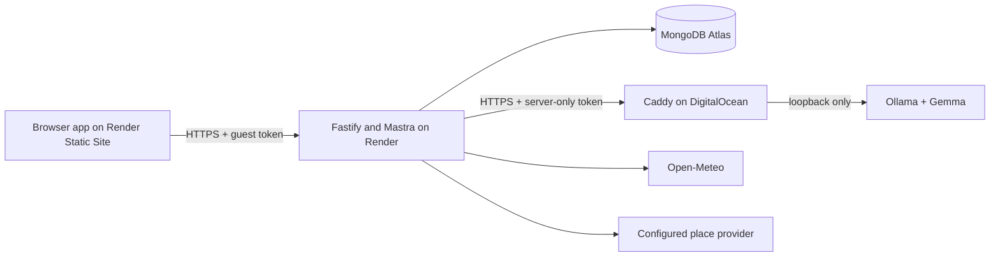

# Web deployment guide

Updated 11 October 2026. The chosen release is the browser app only. No EAS mobile build or app-store submission is needed. The hosted services below are prepared, not yet provisioned or verified.

## What runs where



The frontend is an Expo web export using localStorage for its guest identity, cache and completion queue. Native local reminders are unavailable on web. A cache does not guarantee that the page itself can reopen without a connection: no service worker/offline reload support is configured.

Render, DigitalOcean and Atlas integrations are available but are not yet connected to this chat. Connect them to let the agent inspect your actual resources. The DigitalOcean integration advertises workspace Droplets; GPU provisioning capability still needs checking after connection. If it cannot create a GPU, use the DigitalOcean dashboard or an authenticated doctl setup. Keep credentials in provider settings, not chat or source files.

## 1. Agree on costs and availability

- Render: one paid API service; the existing blueprint selects Starter. Check current compute price and memory usage before creation. Increase memory only if measured startup or inference orchestration requires it.
- Render Static Site: uses the workspace's included bandwidth and build minutes; check quotas and excess-usage charges.
- Atlas: use a Free cluster for this small demo if available in your account/region, or an existing appropriate cluster.
- DigitalOcean: the current RTX 4000 Ada listing is USD 0.76/hour. Compute alone is USD 18.24 for 24 hours, USD 36.48 for 48 hours, and USD 127.68 for seven days. Other services, taxes and retained resources are extra. Powered-off GPU Droplets still incur charges; deletion ends their compute charges. Decide how long judges can use inference before provisioning.

The model in this implementation is `gemma4:e2b`, not the older Gemma 3 tag in the historical plan. Confirm that tag can be pulled and runs on the chosen GPU before promising a live demo.

## 2. Prepare Atlas

1. In Atlas, select the intended project and create/use a Free cluster. Keep demo data separate from other projects.
2. Create a dedicated database user with read/write access to `outsideweek`; use a generated password.
3. Copy the driver's `mongodb+srv://` connection string into Render's secret `MONGODB_URI` setting. URL-encode special characters in the password.
4. After creating the Render API, copy all of its outbound IP ranges from the Render dashboard into Atlas Network Access. Allow those ranges and only the administrator addresses needed for setup. Do not use a permanent global allow rule.
5. Set `MONGODB_DB=outsideweek`. Fresh browser visitors create their own guest records; existing local emulator data is not automatically migrated.

## 3. Host Gemma on DigitalOcean

1. Choose a supported NVIDIA GPU Droplet with enough memory (the planned RTX 4000 Ada has 20 GB VRAM), an SSH key, and a region with quota/capacity. Confirm the displayed hourly rate before creating it. The smaller model may fit another configuration, but it needs a measured latency check.
2. Point an inference subdomain's DNS A record at the Droplet's public IP. The API and web app can keep their generated onrender.com domains; inference needs a hostname for trusted TLS.
3. Install NVIDIA drivers if the selected GPU image does not include them. Verify with `nvidia-smi`. Install Ollama and Caddy using their official Linux installation instructions below.
4. Copy `infra/inference/ollama.override.conf` to `/etc/systemd/system/ollama.service.d/override.conf`. Create the directory first. Run `sudo systemctl daemon-reload` and `sudo systemctl restart ollama`.
5. Run `ollama pull gemma4:e2b`. Check `ollama list`, then run a small local request. Keep Ollama on `127.0.0.1:11434`.
6. Copy `infra/inference/Caddyfile` to `/etc/caddy/Caddyfile`. Copy `infra/inference/caddy.override.conf` to `/etc/systemd/system/caddy.service.d/override.conf`.
7. Create `/etc/caddy/outwards-days.env` from `inference.env.example`, with the actual hostname and a random token generated by `openssl rand -hex 32`. Restrict this file to root with mode 600. Store the same token in Render's server-only `OLLAMA_SERVICE_TOKEN` setting.
8. Reload systemd and restart Caddy. Allow HTTPS and HTTP certificate validation traffic (443 and 80); restrict SSH to your administrator IP. Do not expose 11434. Use DigitalOcean firewall rules to restrict 443 to Render outbound ranges when certificate renewal and your verification path have been accounted for.
9. An unauthenticated request to `/api/chat` must return 401. A valid server-side token should permit a small POST request with the model name, messages, and `stream:false`. Check `/api/tags` on the inference host locally to record the installed model digest. Model administration routes remain blocked through Caddy.

The proxy allows requests up to 2 MB so resized photo-mission images can reach inference. This does not prove a browser camera mission works; verify it over HTTPS separately.

## 4. Deploy the Render API

First make the prepared configuration available on the GitHub branch Render uses. Local edits are not available to Render until committed and pushed.

Create a Blueprint from the repository, choosing `infra/render.yaml` as the blueprint path, or create an equivalent Docker Web Service:

| Field | Value |
| --- | --- |
| Repository | https://github.com/quangvinhlee/Outwards-Days |
| Dockerfile | `apps/api/Dockerfile` |
| Docker context | repository root |
| Health check | `/healthz` |
| Instances | 1 |
| Plan | Starter, subject to memory verification |

Set the environment variables in the API service:

| Variable | Where the value comes from |
| --- | --- |
| `NODE_ENV` | `production` |
| `PORT` | `10000` |
| `MONGODB_URI` | private Atlas driver connection string |
| `MONGODB_DB` | `outsideweek` |
| `OLLAMA_BASE_URL` | actual `https://inference.your-domain` origin, no `/api/chat` suffix |
| `OLLAMA_SERVICE_TOKEN` | private token shared with Caddy |
| `OLLAMA_MODEL` | `gemma4:e2b` |
| `SESSION_TTL_DAYS` | `30` |
| `WEB_ORIGIN` | exact final frontend origin, with `https://` and no trailing slash |
| `OVERPASS_BASE_URL` | production-approved Overpass endpoint, if available |
| `PHOTON_BASE_URL` | production-approved Photon endpoint, if available |
| `SERPAPI_API_KEY` | private key only if using SerpApi |
| `ROUTING_BASE_URL` | optional production route service |

Leave optional provider settings unset when unavailable; if prompted by the current API blueprint, remove the optional empty entries before submission rather than inventing a provider. Production deliberately disables development's default public map endpoints. Core familiar-place suggestions still work, but the nearby browser and mapped hikes need an actual configured provider. SerpApi can supply park results; it does not replace every OpenStreetMap hike/river feature. Public Open-Meteo forecast requests still require coordinates and applicable usage terms.

If the frontend URL is not known yet, deploy the API, create the static site next, then set `WEB_ORIGIN` to its assigned URL and redeploy the API. A passing health check alone does not establish Atlas access, live Gemma success or browser CORS correctness.

## 5. Deploy the web frontend

Create a second Blueprint from `infra/render-web.yaml`, or a Static Site using these settings:

| Field | Value |
| --- | --- |
| Root directory | leave empty; use the monorepo root |
| Build command | `corepack enable && pnpm install --frozen-lockfile && pnpm build:web` |
| Publish directory | `apps/mobile/dist` |
| Node version | `24` |
| `EXPO_PUBLIC_WEB_API_BASE_URL` | actual public HTTPS API origin |
| Rewrite | `/*` → `/index.html` (Rewrite, not Redirect) |

The build script rejects a missing or invalid API origin, so it cannot silently publish a localhost-backed site. This variable is public: do not put the MongoDB URI, inference token, or provider keys in it. Update it and rebuild whenever the public API URL changes.

Copy the resulting frontend origin to the API's `WEB_ORIGIN`, then redeploy the API. Browser CORS uses exact origin matching. Custom domains are optional for the web frontend; remember to update `WEB_ORIGIN` if its domain changes.

For a local build check, replace the sample HTTPS API URL with your real one:

```sh
EXPO_PUBLIC_WEB_API_BASE_URL=https://YOUR-API.onrender.com pnpm build:web
```

## 6. Verify the hosted flow

1. Open the public website in a fresh browser profile. Create a guest identity, set interests and actual availability, review all seven days, and confirm.
2. Generate a plan. Check the source label. `Basic` is a successful fallback, not evidence of live Gemma. Verify a live Gemma result before claiming the hosted AI works.
3. Accept one future suggestion; verify the full time budget. Reload and check the guest identity and saved plan persist.
4. Exercise replacement/rescheduling, then queue a truthful outcome after an actual outing. Confirm reconnect/sync does not duplicate progress.
5. Check `/schedule/...`, `/activity/...` and `/places` survive direct navigation and page refresh through the SPA rewrite.
6. Test optional location and photo capture over HTTPS in your target browser. Verify denial does not block core planning. Native notifications are not available in this web release.
7. Run the existing smoke check against the hosted API:

```sh
API_BASE_URL=https://YOUR-API.onrender.com OLLAMA_MODEL=gemma4:e2b node scripts/smoke-api.mjs
```

This creates and deletes its own temporary guest data, asserts live Gemma generation and acceptance, and uses a synthetic skip to check idempotent synchronization. It does not claim an actual outdoor completion. Do not run it against an unrelated service.

Record real API/frontend URLs, deployment time, commit, selected resource sizes, model digest, hosted latency and any limitations in `docs/submission-readiness.md`. The recorded local evaluation is not a deployed evaluation.

## 7. Finish the submission

Use `docs/submission-draft.md` and the existing private DEV draft. Add the actual live website URL, upload the voiced video and add its public link. Identify that the existing video was captured on Android, while judges now use the browser release. Keep platform differences explicit.

Claim Gemma and Mastra based on working code and evidence. Add Render, DigitalOcean and MongoDB Atlas only after their hosted components work. Add SerpApi only after demonstrating genuine successful search use. Existing narration was generated with edge-tts; it is not ElevenLabs usage. Exporting a session through DevRelay does not establish Entire usage.

Publish one DEV post with `devchallenge` and `hf26challenge`. Deadline: Monday 12 October 2026, 17:59 Melbourne time. This is a DEV-post challenge; no MLH project submission is needed for this entry. Writing quality has the highest judging weight. Show the useful outdoor journey and explain why open-weight inference matters.

## References

- [Expo web publishing](https://docs.expo.dev/guides/publishing-websites/)
- [Render Blueprint specification](https://render.com/docs/blueprint-spec)
- [Render SPA rewrites](https://render.com/docs/deploy-create-react-app#using-client-side-routing)
- [Render outbound IP addresses](https://render.com/docs/outbound-ip-addresses)
- [Render pricing](https://render.com/pricing)
- [Atlas Free cluster setup](https://www.mongodb.com/docs/atlas/tutorial/deploy-free-tier-cluster/)
- [DigitalOcean GPU creation](https://docs.digitalocean.com/products/droplets/how-to/gpu/create/)
- [DigitalOcean GPU prices](https://www.digitalocean.com/pricing/gpu-droplets)
- [Ollama Linux installation](https://docs.ollama.com/linux)
- [Caddy installation](https://caddyserver.com/docs/install)
- [Touch Grass challenge and category criteria](https://dev.to/challenges/hacktoberfest-week1-2026-10-05)
